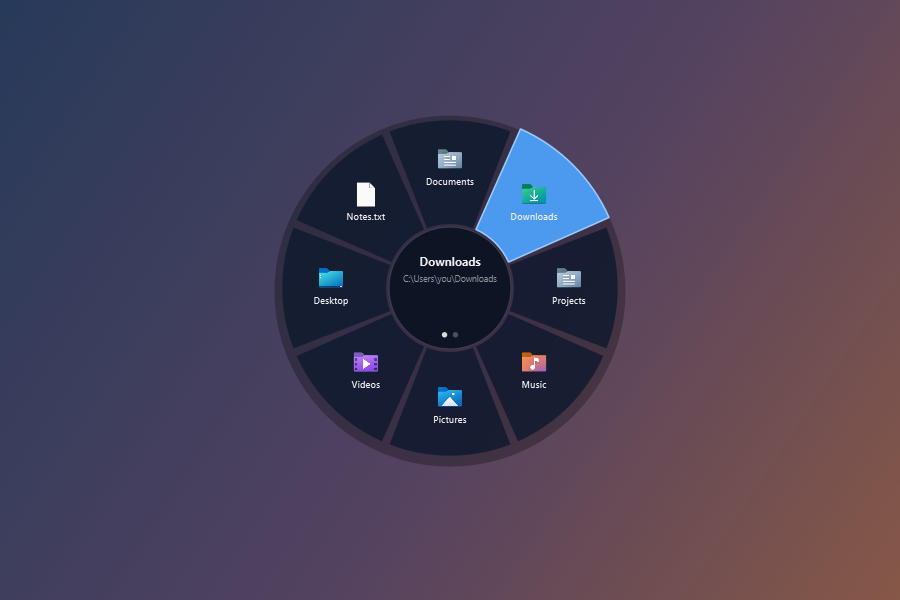
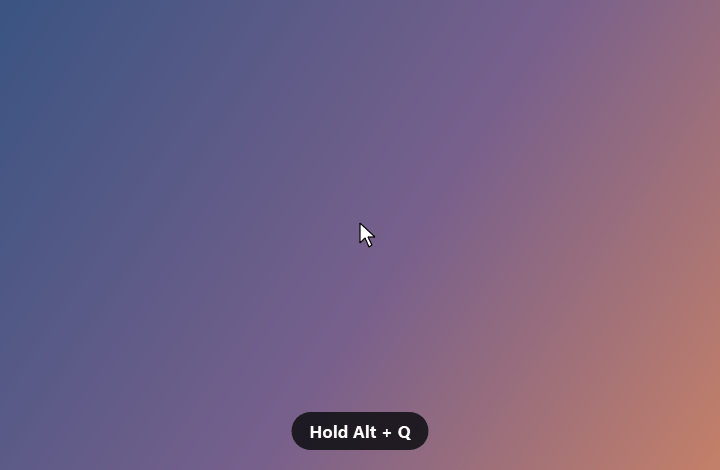
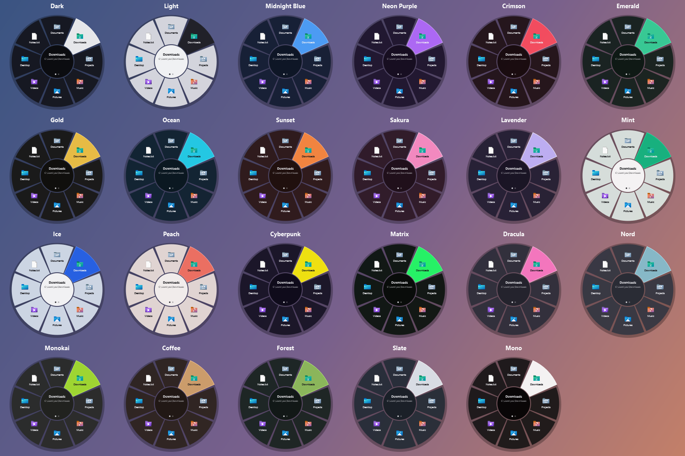
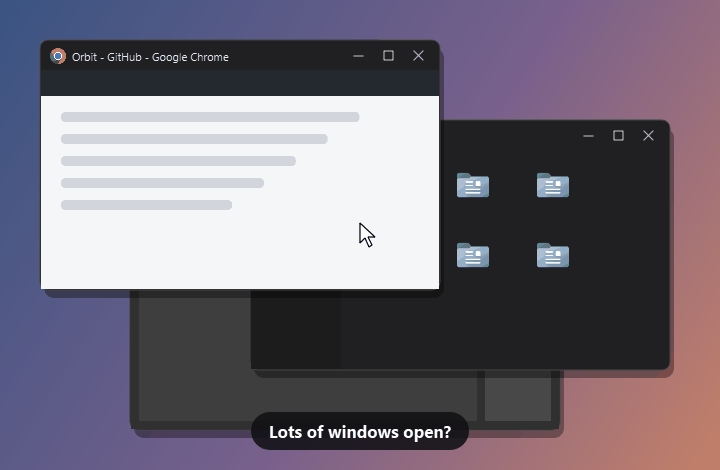
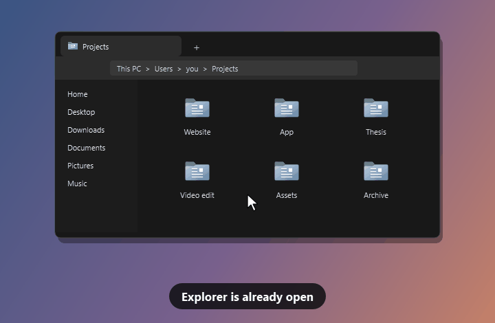
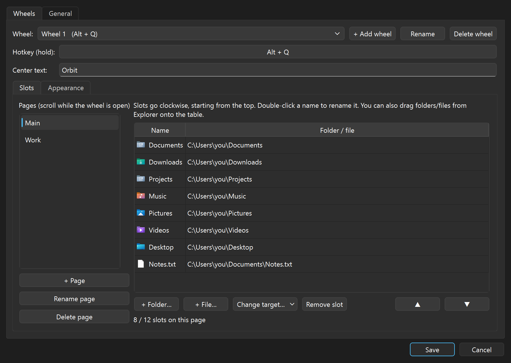
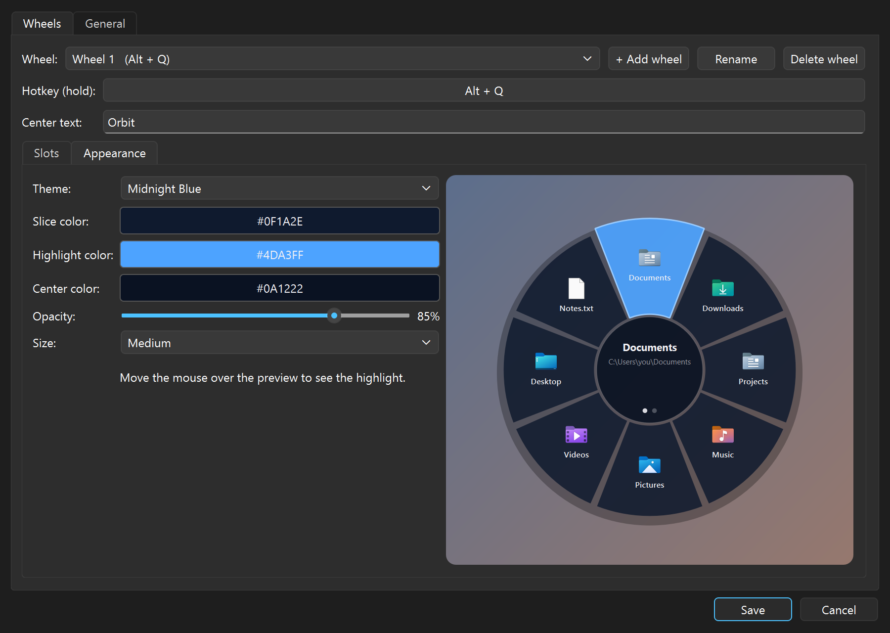
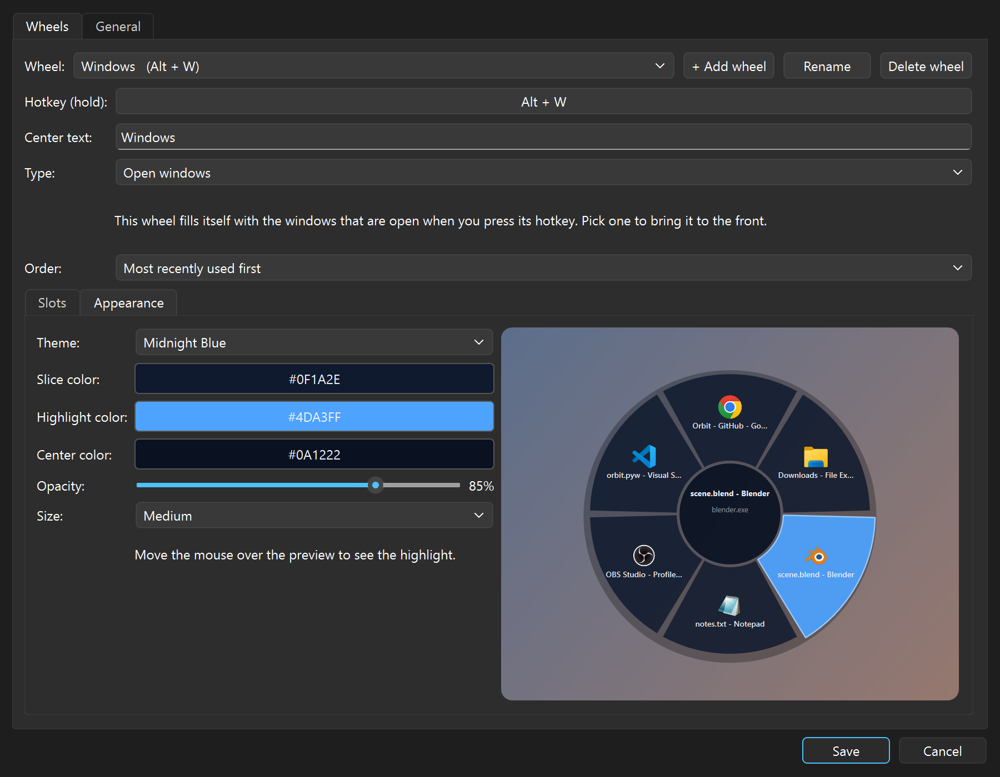
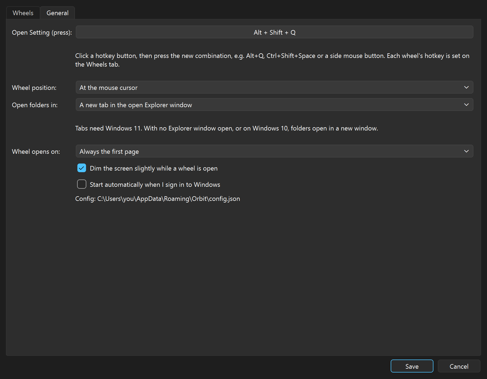

# Orbit

A radial menu for Windows that opens your folders and files, or switches between the windows you have
open. Hold a hotkey, flick the mouse toward a slot, let go, and it opens.



## Demo



1. **Hold** the hotkey (default <kbd>Alt</kbd>+<kbd>Q</kbd>). The wheel appears at your mouse cursor.
2. **Move** the mouse toward a slot. The slot lights up and the center shows its full path.
3. **Release** the hotkey and the folder or file opens.
   Release while the cursor is in the center, press <kbd>Esc</kbd> or right-click, and nothing opens.
4. **Scroll** while the wheel is open to switch between pages (a wheel needs at least two pages for this).
   A wheel opens on its first page by default; you can change that in Setting.

## Features

- **Multiple wheels**, each with its own hotkey, e.g. <kbd>Alt</kbd>+<kbd>Q</kbd> for projects and
  <kbd>Alt</kbd>+<kbd>W</kbd> for work. Two wheels can never share a hotkey.
- Up to 12 slots per page and as many pages as you like. A slot can be a folder or any file.
- **Open windows wheel**: set a wheel's type to *Open windows* and it fills itself with the windows you
  have open each time you press its hotkey, labelled with their titles. Order them most recently used
  first (the default) or alphabetically.
  Pick one to bring it to the front, a quicker Alt+Tab. Browser tabs inside one window count as one slot.
- Add slots by browsing, or by dragging folders and files from Explorer onto the slot list.
- **23 built-in themes** plus custom colors, opacity and size, with a live preview.
- Hotkeys can be any key combination or a side mouse button.
- Folders can open in a new Explorer window or as a new tab in the Explorer window you already have open (Windows 11).
- Starts with Windows and stays out of the way in the system tray.



### Switch windows from the wheel

Give a wheel the *Open windows* type and its hotkey shows every window you have open, newest first or
alphabetically. Point at one and release, and it comes to the front.



### Open folders as Explorer tabs

On Windows 11, folders can open as a new tab in the Explorer window you already have open instead of
piling up new windows. If the folder is already open in a tab, Orbit switches to that tab rather than
adding a duplicate. Turn it on in Setting > General > *Open folders in*.



## Install

Download from the [latest release](https://github.com/ditriz31/Orbit/releases/latest):

| File | What it is |
|---|---|
| `Orbit-Setup-<version>.exe` | **Recommended.** Installs for your user only (no admin rights), adds a Start Menu entry, can start with Windows, and uninstalls from *Settings → Apps*. |
| `Orbit-Portable-<version>.exe` | A single exe that runs without installing, handy on a USB stick. It starts a few seconds slower because it unpacks itself each time. |

Requires Windows 10 or 11 (64-bit).

> **"Windows protected your PC"**: the exe isn't code-signed, so SmartScreen warns about it the first time.
> Click **More info → Run anyway**. If you'd rather not trust a binary, [run it from source](#run-from-source).

## Setting

Press <kbd>Alt</kbd>+<kbd>Shift</kbd>+<kbd>Q</kbd> (or double-click the tray icon) to open **Setting**.



- **Wheels tab:** pick a wheel, set its hotkey, center text and type (*Folders and files* or
  *Open windows*), then fill its pages with slots. *Change target…* also renames the slot after the
  new folder. An *Open windows* wheel has no slots to set up; choose its order instead.
- **Appearance:** choose a theme or your own colors, opacity and size. Hover over the preview to see
  the highlight.
- **General tab:** the Setting shortcut, where the wheel appears (at the cursor or the screen center),
  whether folders open in a new window or a new tab, whether a wheel always opens on its first page
  or on the page you used last, screen dimming and *Start automatically when I sign in to Windows*.







Your settings are saved to `%APPDATA%\Orbit\config.json`, with the previous version kept as
`config.bak.json`. To move your setup to another PC, copy that file over.

## Privacy

Orbit uses a global keyboard and mouse hook, which is how it notices your hotkey while another app is
focused. It only reacts to its own hotkeys, plus Esc, clicks and scrolling while a wheel is open.
It doesn't record or store keystrokes, and it never connects to the internet. An *Open windows* wheel
reads the titles and icons of your open windows only when you press its hotkey, to draw the wheel;
nothing is saved or sent anywhere. The whole app is
[one Python file](orbit.pyw) you can read.

## Run from source

```bash
pip install -r requirements.txt
pythonw orbit.pyw
```

### Build the exe and installer

Needs Python 3.12, `pip install -r requirements.txt pyinstaller` and [Inno Setup 6](https://jrsoftware.org/isinfo.php).

```bash
powershell -ExecutionPolicy Bypass -File build.ps1
```

The setup and portable exe end up in `dist\`. `tools\make_docs_media.py` regenerates the pictures in `docs\`.

## License

[MIT](LICENSE)
